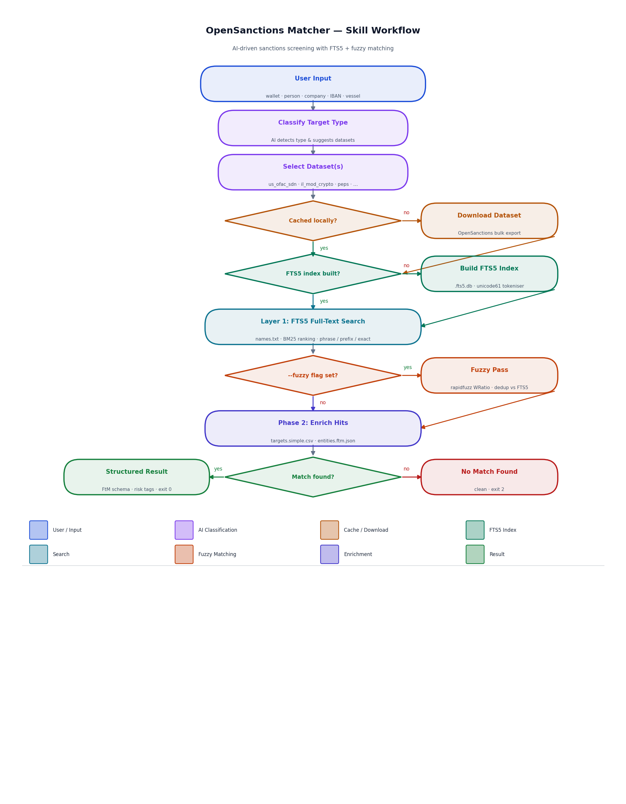

# Opensanctions Matcher AI Skill

[](https://skills.sh/miguelfg/opensanctions-matcher)

An **AI skill** that screens targets against [OpenSanctions](https://www.opensanctions.org/) bulk datasets — no API key, no network calls at search time. Works with Claude Code, Codex, and Gemini to automatically identify the kind of target you want to match against, download the right OpenSanctions dataset, create a searchable index, and run your batch searches against it with full FtM entity context.

Under the hood: SQLite FTS5 full-text search (default) + optional rapidfuzz approximate matching for transliterations and typos.



---

## Quick Start

### In Claude Code:

Simply ask a natural language question — the skill auto-triggers:

```
Is this Bitcoin address sanctioned? 1123pJv8jzeFQaCV4w644pzQJzVWay2zcA
```

Or explicitly invoke:

```
/opensanctions-matcher screen T9yb6vP8o8PQJLNmcCkC9wfk73ULTCy2MB
```

The skill will:
1. Classify the target type (crypto wallet, person, company, etc.)
2. Check your local OpenSanctions cache (`~/.local/share/opensanctions/`)
3. Offer to download fresh data if not cached
4. Run a two-phase search: names first, then enriched CSV/JSON if available
5. Return structured results with FtM entity context

### Standalone CLI (advanced):

```bash
pip install rapidfuzz          # optional, required for --fuzzy
python3 skills/opensanctions-matcher/scripts/os_search.py \
    --dataset-dir ~/.local/share/opensanctions/il_mod_crypto \
    --targets "T9yb6vP8o8PQJLNmcCkC9wfk73ULTCy2MB" --file ftm
```

On first run an FTS5 index is built automatically. Subsequent runs are instant.

---

## Requirements

| Dependency | Required | Purpose |
|---|---|---|
| Python 3.10+ | Yes | Core runtime |
| `rapidfuzz` | No | `--fuzzy` approximate matching |
| `ripgrep` (`rg`) | No | Faster `--no-fts` grep fallback |

---

## Installation

### As an Agent Skill (Claude Code, Codex, Cursor, Gemini, …)

Install with the [skills CLI](https://www.skills.sh/docs/cli):

```bash
npx skills add miguelfg/opensanctions-matcher
pip install rapidfuzz          # optional, required for --fuzzy approximate matching
```

The CLI copies `skills/opensanctions-matcher/` into your agent's skills directory. The skill then triggers on natural language ("is this wallet sanctioned?") or via `/opensanctions-matcher` in Claude Code.

### For Standalone CLI Use

After cloning, the bundled `scripts/os_search.py` can be run directly without any installation:

```bash
python3 skills/opensanctions-matcher/scripts/os_search.py --help
```

No mandatory third-party dependencies — `sqlite3` is in Python's stdlib.

---

## Usage in Claude Code

The skill automatically triggers on these natural language prompts:

- "Is this address sanctioned?"
- "Check if X is on any sanctions lists"
- "Screen this wallet against ransomware trackers"
- "Is this person a known PEP?"
- "Cross-check against OpenSanctions"
- "OFAC check for..."

And responds with:
1. **Automatic dataset selection** — picks the most relevant dataset(s) based on target type
2. **Cache management** — checks local files, offers to download if missing
3. **Two-phase search** — names + enriched CSV/JSON for full entity context
4. **Structured output** — FtM schema interpretation with risk tags, holder lookup, date ranges

The skill handles everything automatically. Just ask a question.

---

## Examples

### 1. Crypto Wallet Sanctions Check
```
Is this Bitcoin address sanctioned? 1123pJv8jzeFQaCV4w644pzQJzVWay2zcA
```
→ Detects wallet address, searches `il_mod_crypto` and `ransomwhere` datasets, returns holder info.

### 2. OFAC Person Lookup
```
Check if Vladimir Putin appears on any OFAC sanctions lists.
```
→ Detects person name, searches `us_ofac_sdn`, returns schema, topics, date range.

### 3. Batch Address Screening
```
Cross-check these Ethereum addresses: 0x0004a76e39d33edfeac7fc3c8d3994f54428a0be, 0x7d84d78bb9b6044a45fa08b7fe109f2c8648ab4e
```
→ Detects multiple wallet addresses, screens each against `us_fbi_lazarus_crypto`, deduplicates results.

### 4. PEP Verification
```
Is Alina Kabaeva a known PEP?
```
→ Detects person, searches `peps` dataset, filters by `Person` schema.

### 5. Fuzzy Matching for Typos
```
Check if "Vladmir Putin" (with typo) is on OFAC. Allow for spelling variations.
```
→ FTS5 misses the misspelling; fuzzy matching finds "Vladimir Putin" (score 96) in `us_ofac_sdn`.

## Standalone CLI Usage

For advanced use without the AI client, the bundled script can be run directly:

```bash
# Verify cached datasets
ls ~/.local/share/opensanctions/*/names.txt

# Run a search
python3 skills/opensanctions-matcher/scripts/os_search.py \
    --dataset-dir ~/.local/share/opensanctions/<dataset_name> \
    --targets "TARGET"

# Use fuzzy matching
python3 skills/opensanctions-matcher/scripts/os_search.py \
    --dataset-dir ~/.local/share/opensanctions/us_ofac_sdn \
    --targets "Vladmir Putin" --fuzzy 75

# Disable FTS5, use grep fallback
python3 skills/opensanctions-matcher/scripts/os_search.py \
    --dataset-dir ~/.local/share/opensanctions/us_ofac_sdn \
    --targets "Putin" --no-fts

# Search wallet addresses / identifiers in the full FtM entities file
python3 skills/opensanctions-matcher/scripts/os_search.py \
    --dataset-dir ~/.local/share/opensanctions/us_fbi_lazarus_crypto \
    --targets "0x0004a76e39d33edfeac7fc3c8d3994f54428a0be" --file ftm
```

See [OpenSanctions Dataset Catalogue](https://www.opensanctions.org/browse/) to find the right dataset for your target type.

---

## Architecture

### Skill Integration

The installable skill is `skills/opensanctions-matcher/` (`SKILL.md`, `references/`, `scripts/os_search.py`). `npx skills add` copies it into each agent's skills directory (e.g. `~/.claude/skills/`, `~/.agents/skills/`).

The `SKILL.md` metadata file defines:
- Trigger phrases (e.g., "check sanctions", "is this wallet sanctioned")
- Workflow steps (dataset selection → cache check → download → search)
- Result interpretation rules

When triggered, the skill:
1. **Identifies target type** — analyzes what you're searching for (wallet address, person name, company, vessel, etc.)
2. **Selects dataset** — downloads the right OpenSanctions dataset for that target type
3. **Creates search index** — builds a SQLite FTS5 index for fast searching
4. **Runs batch search** — searches all your targets against the indexed dataset
5. **Manages cache** — reuses indexes if already built, checks staleness
6. **Interprets results** — formats output with FtM schema, risk tags, holder lookup

### Search Technology

The bundled script (`scripts/os_search.py`) implements a two-layer search:

**Layer 1: SQLite FTS5 (Full-Text Search)**
- Default search engine — ranked, token-aware
- Separate `.fts5.db` index per dataset file
- Transparent index build on first run, auto-rebuild when source is newer
- `unicode61` tokenizer for accent-folding, case-insensitivity

**Layer 2: Rapidfuzz Approximate Matching (optional)**
- Activates with `--fuzzy [THRESHOLD]` flag
- Runs after FTS5 to find near-misses (transliterations, typos, OCR noise)
- Uses WRatio scorer, deduplicates against FTS5 hits
- Performance warning on large datasets (>500k entries)

**Fallback: Grep/Substring (optional)**
- Activates with `--no-fts` flag
- Restores original case-insensitive substring search
- Useful when FTS5 is unavailable or for debugging

---

## How It Works

### FTS5 index lifecycle

On first search against a dataset file, `os_search.py` builds a SQLite FTS5 index (`.fts5.db`) next to the source file. The index is rebuilt automatically whenever the source file is newer than the index — no manual cache management needed. Pass `--no-fts` to skip the index entirely and fall back to the original grep path.

### Query strategy

| Target pattern | FTS5 query | Rationale |
|---|---|---|
| Multi-word (`"Vladimir Putin"`) | `"vladimir putin"` | Phrase search — tokens must appear in sequence |
| Single word (`"Gazprom"`) | `gazprom OR gazprom*` | Exact token plus prefix — catches partial inputs |
| Crypto address (≥ 20 alnum chars) | exact token | Single-token exact match |

Results are ranked by BM25 and deduplicated by entity `id`.

### Fuzzy layer

When `--fuzzy` is active, a second pass runs `rapidfuzz.process.extract` with the WRatio scorer over all indexed captions. Only hits not already returned by FTS5 are included, labelled `⚠️  FUZZY MATCH`.

---

## Supported Dataset File Types

| File | Indexed columns | Output |
|---|---|---|
| `names.txt` | `name` | Matched lines |
| `targets.simple.csv` | `caption`, `aliases`, `identifiers` | Full CSV row as dict |
| `entities.ftm.json` | `caption`, `names`, `aliases`, `identifiers` | Parsed FtM entity with all properties |

---

## Output Format

```
============================================================
OpenSanctions Search
  Dataset : il_mod_crypto
  File    : names.txt
  Targets : 1
============================================================

── Searching: TUFXua1qzfCsFpcZEGXaU7oGFURqQ7RQpy
  ✅ FTS MATCH (1 line(s))
  Matched : TUFXua1qzfCsFpcZEGXaU7oGFURqQ7RQpy
  Web URL : https://www.opensanctions.org/search/?scope=il_mod_crypto&q=...

── Phase 2: enriching 1 hit(s) from targets.simple.csv

  Enrichment for TUFXua1qzfCsFpcZEGXaU7oGFURqQ7RQpy (match 1):
  ...

── Searching: Aleksei Navalnyy   (with --fuzzy 70)
  ⚠️  FUZZY MATCH (score: 87) — Alexei Navalny
```

Exit code `0` when at least one match is found; `2` when no matches.

---

## License & Attribution

**This skill:**
- Licensed under the MIT License (see [LICENSE](LICENSE))
- Uses OpenSanctions bulk data (free for non-commercial use)
- OpenSanctions data is licensed under [CC BY-NC 4.0](https://creativecommons.org/licenses/by-nc/4.0/)
- Commercial use of OpenSanctions data requires a data license

See [OpenSanctions Licensing](https://www.opensanctions.org/) for details.
